

  <a href="https://jvk.to">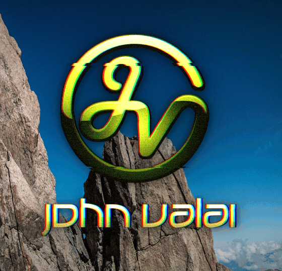</a>

# 👋🏻 <picture><source media="(prefers-color-scheme: dark)" srcset="./assets/generated/headings/h1-hi-there-dark.svg"></picture>

<!--
  Icons from:
    https://github.com/simple-icons/simple-icons
    https://simpleicons.org/?q=chart
    https://github.com/simpleicons/simpleicons.now.sh
    https://simpleicons.vercel.app/git/F05032
-->

<!-- Icons are generated from src/data/mystack.yml -->
Tech that I enjoy using:
<!-- START mystack -->
<a href="https://cdn.jsdelivr.net/gh/jv-k/jv-k@main/assets/generated/cards/languages.svg?v=fd622395"><picture><source media="(prefers-color-scheme: dark)" srcset="./assets/generated/cards/languages-dark.svg"/>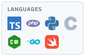</picture></a> <a href="https://cdn.jsdelivr.net/gh/jv-k/jv-k@main/assets/generated/cards/backend.svg?v=9f9b101c"><picture><source media="(prefers-color-scheme: dark)" srcset="./assets/generated/cards/backend-dark.svg"/>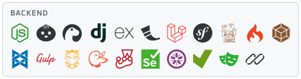</picture></a> <a href="https://cdn.jsdelivr.net/gh/jv-k/jv-k@main/assets/generated/cards/frontend.svg?v=c2ee479b"><picture><source media="(prefers-color-scheme: dark)" srcset="./assets/generated/cards/frontend-dark.svg"/>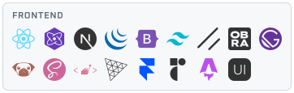</picture></a> <a href="https://cdn.jsdelivr.net/gh/jv-k/jv-k@main/assets/generated/cards/cross-platform.svg?v=0c9bae0e"><picture><source media="(prefers-color-scheme: dark)" srcset="./assets/generated/cards/cross-platform-dark.svg"/>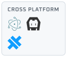</picture></a> <a href="https://cdn.jsdelivr.net/gh/jv-k/jv-k@main/assets/generated/cards/js-ts-tooling.svg?v=21d75362"><picture><source media="(prefers-color-scheme: dark)" srcset="./assets/generated/cards/js-ts-tooling-dark.svg"/>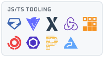</picture></a> <a href="https://cdn.jsdelivr.net/gh/jv-k/jv-k@main/assets/generated/cards/api.svg?v=871114fd"><picture><source media="(prefers-color-scheme: dark)" srcset="./assets/generated/cards/api-dark.svg"/>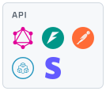</picture></a> <a href="https://cdn.jsdelivr.net/gh/jv-k/jv-k@main/assets/generated/cards/devops.svg?v=a89dfac7"><picture><source media="(prefers-color-scheme: dark)" srcset="./assets/generated/cards/devops-dark.svg"/>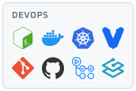</picture></a> <a href="https://cdn.jsdelivr.net/gh/jv-k/jv-k@main/assets/generated/cards/dbs.svg?v=eaa65d42"><picture><source media="(prefers-color-scheme: dark)" srcset="./assets/generated/cards/dbs-dark.svg"/>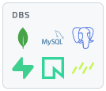</picture></a> <a href="https://cdn.jsdelivr.net/gh/jv-k/jv-k@main/assets/generated/cards/cloud.svg?v=f8de4da8"><picture><source media="(prefers-color-scheme: dark)" srcset="./assets/generated/cards/cloud-dark.svg"/>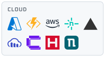</picture></a> <a href="https://cdn.jsdelivr.net/gh/jv-k/jv-k@main/assets/generated/cards/observability.svg?v=5fc7d4b4"><picture><source media="(prefers-color-scheme: dark)" srcset="./assets/generated/cards/observability-dark.svg"/>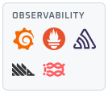</picture></a> <a href="https://cdn.jsdelivr.net/gh/jv-k/jv-k@main/assets/generated/cards/cli.svg?v=f08639ab"><picture><source media="(prefers-color-scheme: dark)" srcset="./assets/generated/cards/cli-dark.svg"/>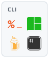</picture></a> <a href="https://cdn.jsdelivr.net/gh/jv-k/jv-k@main/assets/generated/cards/ai-models.svg?v=ee3808be"><picture><source media="(prefers-color-scheme: dark)" srcset="./assets/generated/cards/ai-models-dark.svg"/>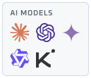</picture></a> <a href="https://cdn.jsdelivr.net/gh/jv-k/jv-k@main/assets/generated/cards/coding-agents.svg?v=7c194217"><picture><source media="(prefers-color-scheme: dark)" srcset="./assets/generated/cards/coding-agents-dark.svg"/>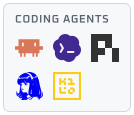</picture></a> <a href="https://cdn.jsdelivr.net/gh/jv-k/jv-k@main/assets/generated/cards/ai-tooling.svg?v=c8cb1b8c"><picture><source media="(prefers-color-scheme: dark)" srcset="./assets/generated/cards/ai-tooling-dark.svg"/>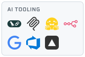</picture></a> <a href="https://cdn.jsdelivr.net/gh/jv-k/jv-k@main/assets/generated/cards/ml-data-science.svg?v=9feb926f"><picture><source media="(prefers-color-scheme: dark)" srcset="./assets/generated/cards/ml-data-science-dark.svg"/>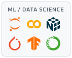</picture></a> <a href="https://cdn.jsdelivr.net/gh/jv-k/jv-k@main/assets/generated/cards/graphics.svg?v=b76dd182"><picture><source media="(prefers-color-scheme: dark)" srcset="./assets/generated/cards/graphics-dark.svg"/>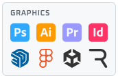</picture></a> <a href="https://cdn.jsdelivr.net/gh/jv-k/jv-k@main/assets/generated/cards/editors.svg?v=d029265f"><picture><source media="(prefers-color-scheme: dark)" srcset="./assets/generated/cards/editors-dark.svg"/>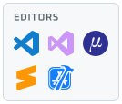</picture></a> <a href="https://cdn.jsdelivr.net/gh/jv-k/jv-k@main/assets/generated/cards/os.svg?v=6316ff1b"><picture><source media="(prefers-color-scheme: dark)" srcset="./assets/generated/cards/os-dark.svg"/>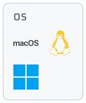</picture></a> <a href="https://cdn.jsdelivr.net/gh/jv-k/jv-k@main/assets/generated/cards/hardware.svg?v=c92a7347"><picture><source media="(prefers-color-scheme: dark)" srcset="./assets/generated/cards/hardware-dark.svg"/>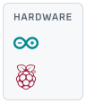</picture></a> <a href="https://cdn.jsdelivr.net/gh/jv-k/jv-k@main/assets/generated/cards/productivity.svg?v=d18a3109"><picture><source media="(prefers-color-scheme: dark)" srcset="./assets/generated/cards/productivity-dark.svg"/>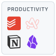</picture></a> 
<!-- END mystack -->

## <picture><source media="(prefers-color-scheme: dark)" srcset="./assets/generated/headings/h2-interests-dark.svg"></picture>

▲ ML ▲ SDLC ▲ CD/CI Automation ▲ Design Principles ▲ Design Patterns

## <picture><source media="(prefers-color-scheme: dark)" srcset="./assets/generated/headings/h2-fun-stuff-dark.svg"></picture>

▲ Electronics/MCUs/FPGAs ▲ Robotics ▲ Aero R/C ▲ Guitars + Amps ▲ Audio electronics ▲ Underwater electronics

  <a href="https://github.com/jv-k/jv-k" alt="generated dynamically">🤖</a>

<!-- Made with 🖤 -->
